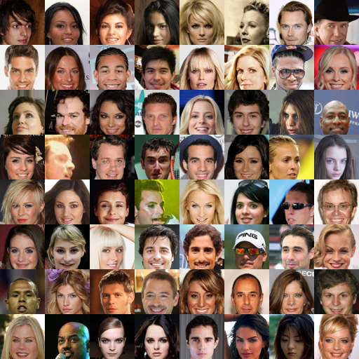
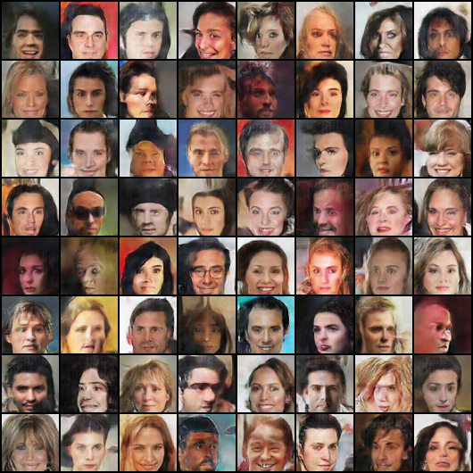
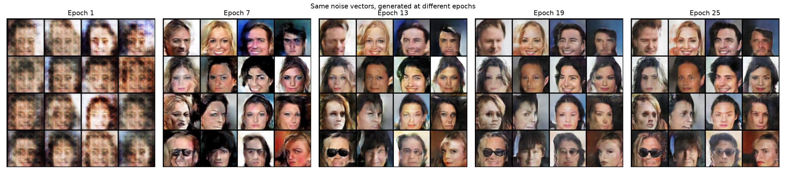
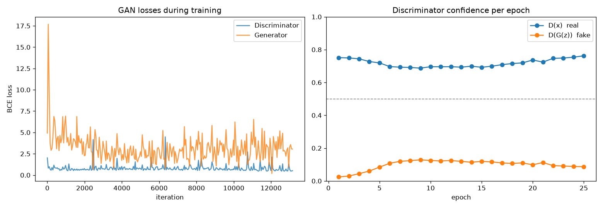
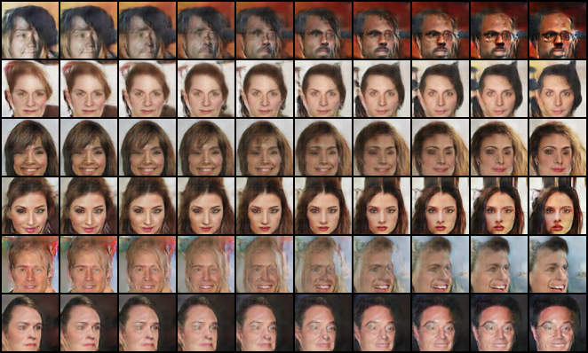

# Realistic Human Face Generation using GAN

A Deep Convolutional GAN (DCGAN) in PyTorch that learns to generate realistic synthetic
human faces (64x64) from random noise, trained on the CelebA dataset.

## Objective
- Understand how GANs generate new realistic images.
- Build a **Generator** that turns a 100-d noise vector into a face image.
- Build a **Discriminator** that classifies images as real or fake.
- Train both together with **adversarial learning**.
- Evaluate generated face quality during training.

## Project structure
| File | Purpose |
|---|---|
| `prepare_data.py` | Downloads CelebA (Hugging Face `nielsr/CelebA-faces`), **crops** the face, **resizes** to 64x64, saves `data/faces_64.npy` and `outputs/real_faces.png` |
| `models.py` | DCGAN `Generator` (ConvTranspose + BatchNorm + ReLU, Tanh output) and `Discriminator` (Conv + BatchNorm + LeakyReLU) with DCGAN weight init |
| `train.py` | Adversarial training with random latent vectors; **normalizes** images to [-1, 1]; logs losses, D(x), D(G(z)); saves fixed-noise samples and checkpoints every epoch |
| `generate.py` | Loss curves, progress comparison over epochs, training GIF, final faces, latent interpolation |

## How it works
1. **Discriminator step** – maximize `log D(x) + log(1 − D(G(z)))` on a batch of real faces
   (label 0.9, one-sided label smoothing) and fake faces (label 0).
2. **Generator step** – maximize `log D(G(z))` (non-saturating loss) so fakes get classified as real.
3. Adam (lr 2e-4, β1 0.5), batch 128, random horizontal flips.
4. A **fixed** batch of 64 noise vectors is rendered after every epoch, so the same faces can be
   compared over time (`outputs/samples/epoch_XXX.png`).

## Run
```bash
pip install torch torchvision numpy pillow pyarrow matplotlib tqdm huggingface_hub
python prepare_data.py --shards 1        # ~67k faces (use --shards 3 for all ~200k)
python train.py --epochs 25              # add --resume to continue from checkpoints/last.pt
python generate.py
```

## Results
Results are written to `outputs/` — see [RESULTS.md](RESULTS.md) for the training run.

| Real faces | Generated faces |
|---|---|
|  |  |




